<div align="center">

# Machine Learning Part 3 — Road Damage Detection with YOLO11: Potholes, Cracks & Manholes


[](https://rishabh-bgp.github.io/machine-learning-part-3/)


**[▶ Open the live demo — ROAD//SCAN](https://rishabh-bgp.github.io/machine-learning-part-3/)**

</div>

**Object detection in Python** with **Ultralytics YOLO11**: `yolo11n` is fine-tuned to find **potholes, cracks and
manholes** in road photos, evaluated with real validation metrics, exported to **ONNX**, and served as a static web app
where the model runs **entirely in your browser** (no server, images never leave your device).

> Practice work by **Rishabh Aryan** for the **6-Month Industrial Training & Certification Program in Artificial Intelligence and Machine Learning**, jointly offered by [IIT Ropar](https://www.iitrpr.ac.in/) and [NIELIT Ropar](https://www.nielit.gov.in/ropar/), under MeitY, Govt. of India.
> Previous parts: [Machine Learning Part 1](https://github.com/Rishabh-bgp/machine-learning-part-1) · [Machine Learning Part 2](https://github.com/Rishabh-bgp/machine-learning-part-2).

---

## 🛣️ Live demo — ROAD//SCAN

<p align="center">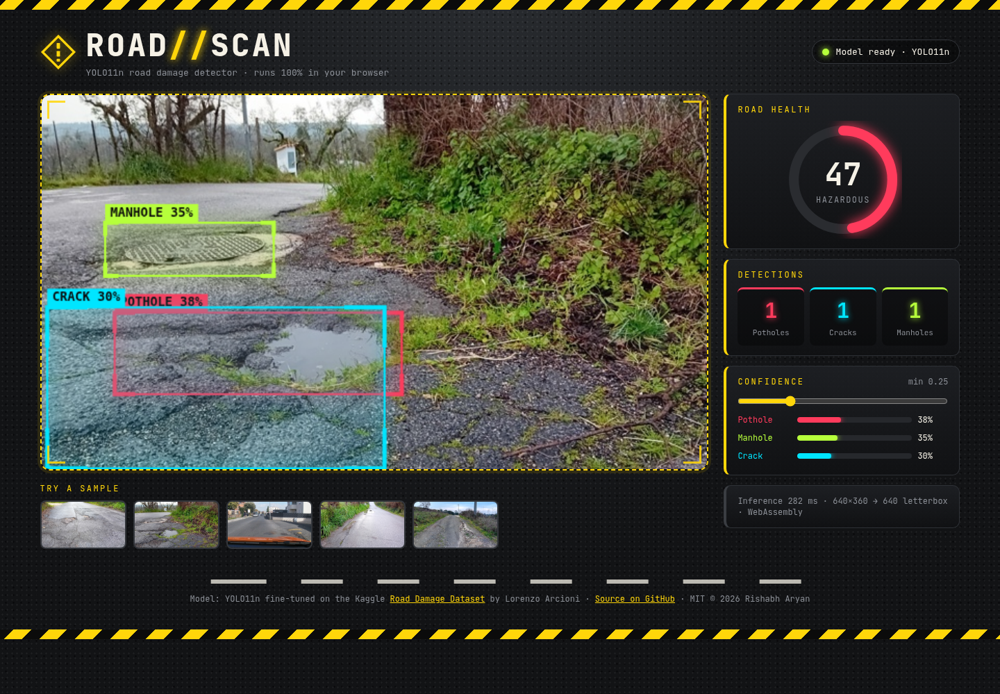</p>

Drag and drop a road photo (or pick a sample) and a scanning laser sweeps the image while YOLO11n runs through
ONNX Runtime Web (WebAssembly). Detections appear as glowing boxes per class, with animated counters, confidence bars,
an adjustable confidence threshold and a **road health score** (100 minus a penalty weighted by pothole and crack count
and area; manholes are not counted as damage). Works on phones too ([mobile screenshot](docs/screenshot_mobile.png)).

## 📚 Notebook and script

| # | Notebook / script | Task | Topics | Model |
|---|---|---|---|---|
| 1 | [01_road_damage_detection_yolo11.ipynb](notebooks/01_road_damage_detection_yolo11.ipynb) · [script](scripts/road_damage_detection.py) | 3-class object detection | Kaggle download with `kagglehub`, dataset inspection, 80/20 YOLO split, fine-tuning, validation (P/R/mAP), predictions, ONNX export | `yolo11n` (fine-tuned) |

## 📈 Results (from the executed notebook)

`yolo11n`, 30 epochs, 640 px, CPU · 1,608 training / 401 validation images · best weights on the validation set:

| Class | Val instances | Precision | Recall | mAP50 | mAP50-95 |
|---|---|---|---|---|---|
| **All** | 548 | 0.531 | 0.500 | **0.496** | **0.225** |
| Pothole | 160 | 0.574 | 0.283 | 0.383 | 0.148 |
| Crack | 309 | 0.410 | 0.366 | 0.336 | 0.128 |
| Manhole | 79 | 0.609 | 0.851 | 0.770 | 0.398 |

Manholes are detected reliably; thin cracks and irregular potholes are harder, mainly in recall.
Full details in [results/RESULTS.md](results/RESULTS.md).

## 🖼️ Output gallery

Predictions of the fine-tuned model on validation images (confidence ≥ 0.25):

<table>
  <tr>
    <td align="center" width="50%">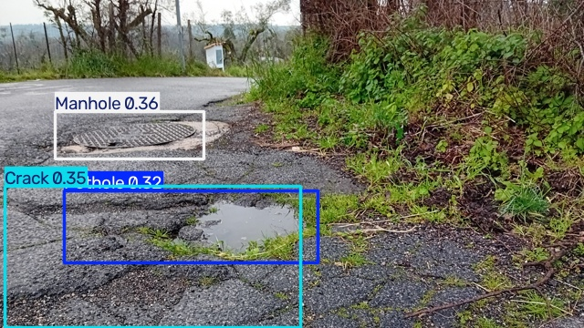<br><sub>20250219_164813.jpg — prediction</sub></td>
    <td align="center" width="50%">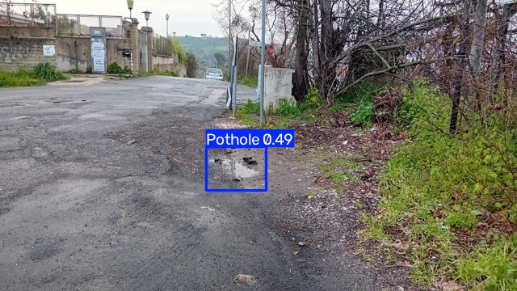<br><sub>20250219_164912.jpg — prediction</sub></td>
  </tr>
  <tr>
    <td align="center" width="50%">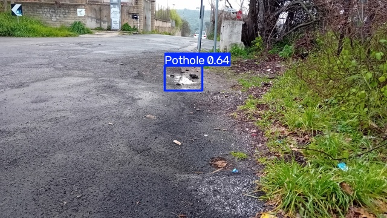<br><sub>20250219_164919.jpg — prediction</sub></td>
    <td align="center" width="50%">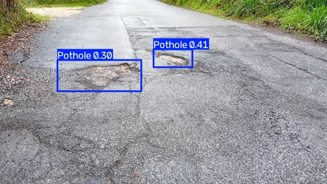<br><sub>20250219_165100.jpg — prediction</sub></td>
  </tr>
  <tr>
    <td align="center" width="50%">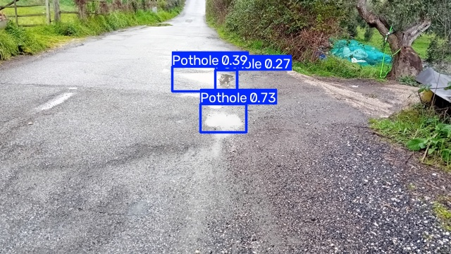<br><sub>20250219_165333.jpg — prediction</sub></td>
    <td align="center" width="50%">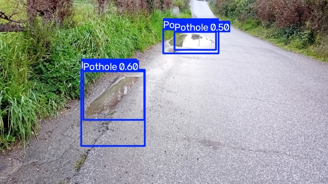<br><sub>20250219_165411.jpg — prediction</sub></td>
  </tr>
  <tr>
    <td align="center" width="50%">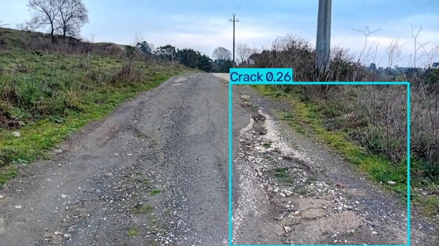<br><sub>20250219_170253.jpg — prediction</sub></td>
    <td align="center" width="50%">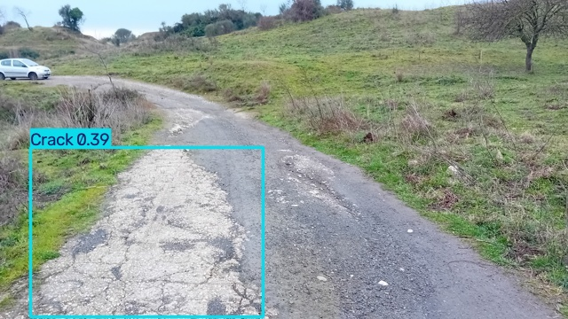<br><sub>20250219_170332.jpg — prediction</sub></td>
  </tr>
</table>

### Evaluation

<table>
  <tr>
    <td align="center" width="50%">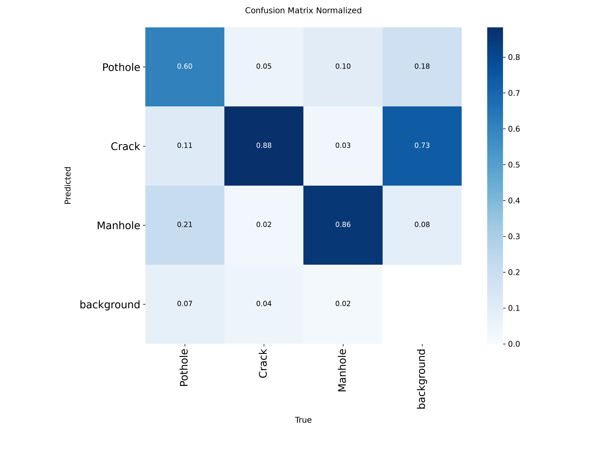<br><sub>Normalised confusion matrix</sub></td>
    <td align="center" width="50%">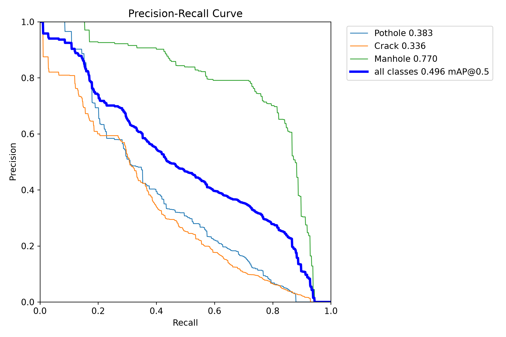<br><sub>Precision–recall curves</sub></td>
  </tr>
  <tr>
    <td align="center" width="50%">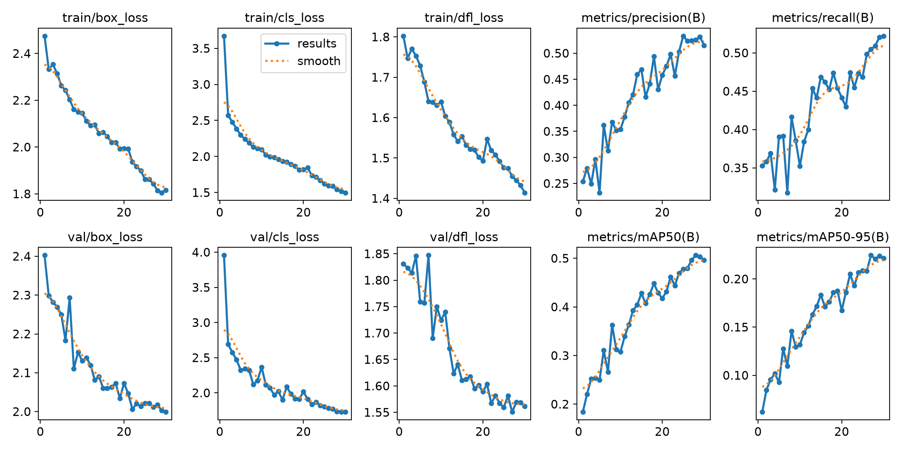<br><sub>Training curves (30 epochs)</sub></td>
    <td align="center" width="50%">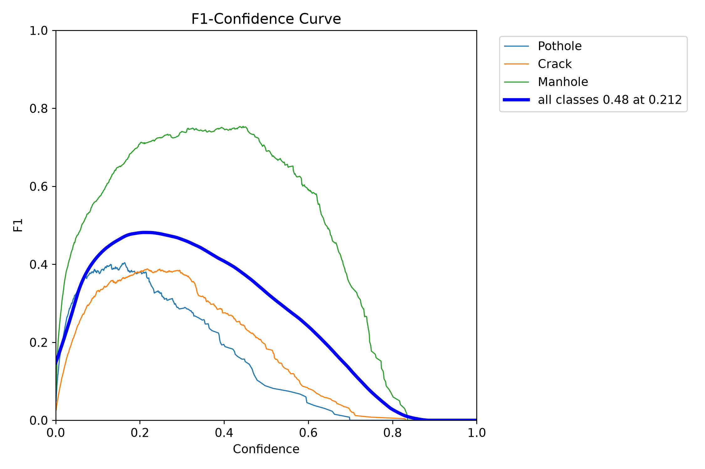<br><sub>F1–confidence curve</sub></td>
  </tr>
  <tr>
    <td align="center" width="50%">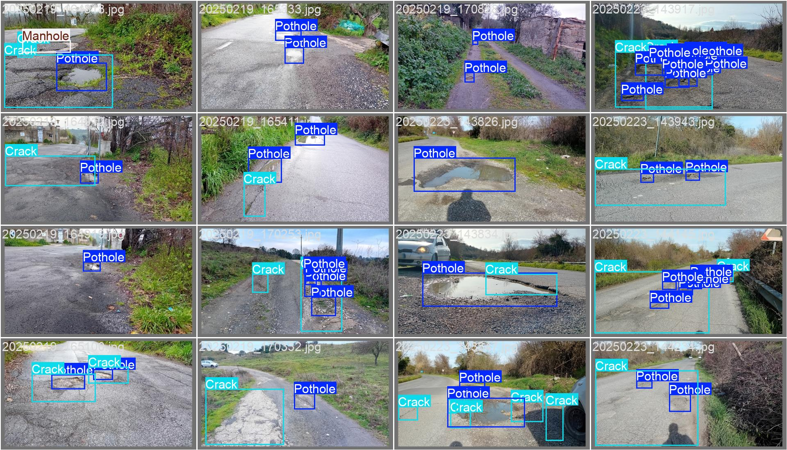<br><sub>Validation batch — ground truth</sub></td>
    <td align="center" width="50%">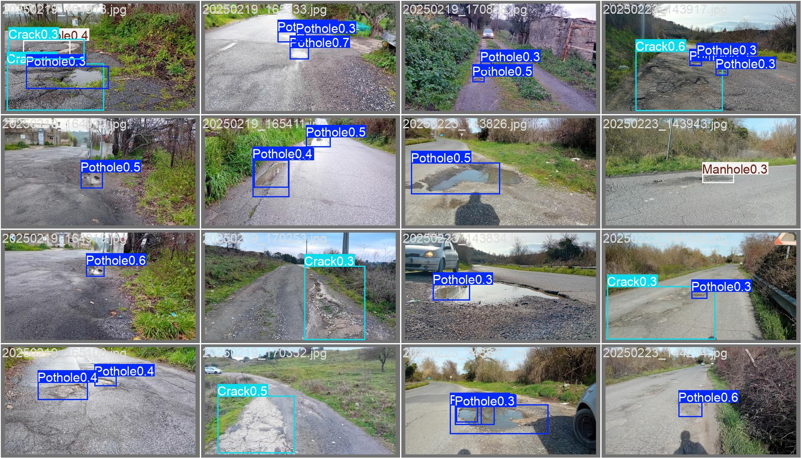<br><sub>Validation batch — predictions</sub></td>
  </tr>
</table>

## 🗂️ Data
[Road Damage Dataset: Potholes, Cracks and Manholes](https://www.kaggle.com/datasets/lorenzoarcioni/road-damage-dataset-potholes-cracks-and-manholes)
by **Lorenzo Arcioni** on Kaggle (MIT licence): 2,009 images at 640 × 360 with 1,261 potholes, 2,519 cracks and 957 manholes,
annotated as quadrilaterals and provided as ready-made YOLO boxes (`labels-YOLO/`), which are used here.
The dataset is **not** committed; it is downloaded at run time:

```python
import kagglehub

# Download latest version
path = kagglehub.dataset_download("lorenzoarcioni/road-damage-dataset-potholes-cracks-and-manholes")

print("Path to dataset files:", path)
```
The five sample images in the web demo (`docs/samples/`) are validation images from this dataset.

## 🚀 How to run
```bash
git clone https://github.com/Rishabh-bgp/machine-learning-part-3.git
cd machine-learning-part-3
python -m venv .venv && source .venv/bin/activate
pip install -r requirements.txt
jupyter lab notebooks/          # or: python scripts/road_damage_detection.py
```
Set `EPOCHS` to change the training length (default 30). Use the trained model directly:
```python
from ultralytics import YOLO
model = YOLO("models/best.pt")
model.predict("your_road_photo.jpg", conf=0.25, save=True)
```
Run the web demo locally: `cd docs && python -m http.server 8000`, then open http://localhost:8000.

## 📁 Repository layout
```
notebooks/   executed Jupyter notebook
scripts/     plain-Python version of the notebook
results/     training curves, validation plots, predictions, RESULTS.md
models/      best.pt (PyTorch, 5.3 MB) and best.onnx (11 MB)
docs/        ROAD//SCAN web app served by GitHub Pages (index.html, style.css, app.js, detect.js, model/, samples/)
requirements.txt  LICENSE  README.md
```

## 🔗 Machine Learning series
- [Machine Learning Part 1](https://github.com/Rishabh-bgp/machine-learning-part-1) — heart-disease classification & insurance-cost regression
- [Machine Learning Part 2](https://github.com/Rishabh-bgp/machine-learning-part-2) — YOLO11 task tour & potato leaf disease classification
- **Machine Learning Part 3** — road damage detection (this repository)
- [Responsible AI on UCI Adult](https://github.com/Rishabh-bgp/responsible-ai-uci-adult) — fairness, explainability & governance audit · [live dashboard](https://rishabh-bgp.github.io/responsible-ai-uci-adult/)
- [NIELIT Machine Learning Projects](https://github.com/Rishabh-bgp/NIELIT-MACHINE-LEARNING-PROJECTS)
- [All repositories](https://github.com/Rishabh-bgp?tab=repositories)

## 📄 License
[MIT](LICENSE) © 2026 Rishabh Aryan. The dataset belongs to its Kaggle author (MIT); YOLO11 is by Ultralytics (AGPL-3.0);
ONNX Runtime Web is by Microsoft (MIT).
